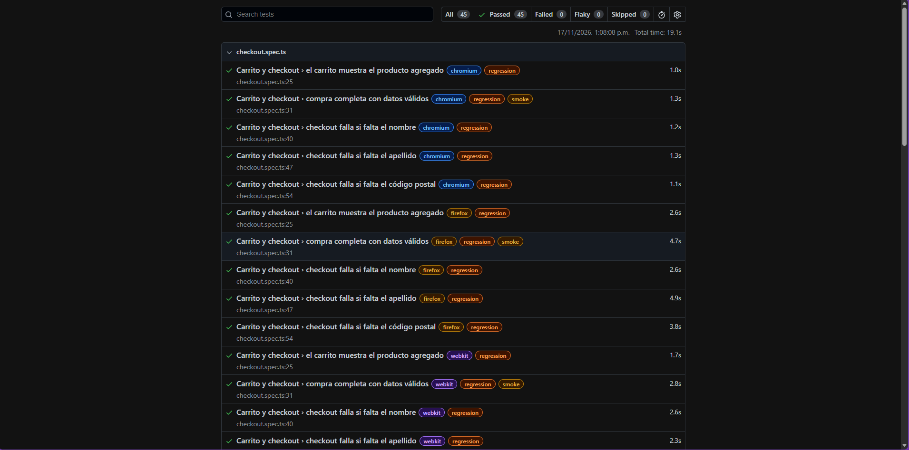

# Playwright E2E — SauceDemo


Suite de pruebas end-to-end con **Playwright** y **TypeScript** sobre [SauceDemo](https://www.saucedemo.com), un sitio de práctica para automatización. Usa el patrón **Page Object Model** y corre automáticamente en **GitHub Actions**.

## Qué se prueba

| Área | Cobertura |
|---|---|
| Login | Acceso exitoso, contraseña incorrecta, usuario vacío, contraseña vacía, usuario inexistente y usuario bloqueado |
| Inventario | Listado de productos, ordenamiento por precio, agregar y quitar del carrito |
| Carrito y checkout | Producto en el carrito, compra completa y validaciones de campos obligatorios |

## Stack

- Playwright + TypeScript
- Page Object Model
- GitHub Actions (CI)
- Reporte HTML de Playwright

## Estructura

```text
├── .github/workflows/playwright.yml
├── data/           # Datos de prueba (usuarios)
├── pages/          # Page Objects (LoginPage, InventoryPage, CartPage, CheckoutPage)
├── tests/          # Specs: login, inventory, checkout
└── playwright.config.ts
```

## Cómo ejecutarlo

```bash
npm install
npx playwright install
npm test                 # toda la suite
npm run test:smoke       # solo pruebas @smoke
npm run test:regression  # solo pruebas @regression
npm run report           # abre el reporte HTML
```

## Etiquetas

- `@smoke`: validación rápida de lo esencial (login, inventario, compra).
- `@regression`: suite completa.

## Reporte



## CI/CD

En cada push o pull request a `main` se ejecuta la suite completa y el reporte HTML se guarda como artefacto del workflow.

## Decisiones técnicas

- **Page Object Model:** separa los selectores de las pruebas y reduce el mantenimiento.
- **Datos en `data/`:** los usuarios no están repetidos en cada test.
- **Aserciones con espera automática:** se evitan pausas fijas.

## Próximos pasos

- Pruebas de regresión visual.
- Ejecución en varios navegadores.
- Publicar el reporte en GitHub Pages.

## Autor

Yair Uriel García González